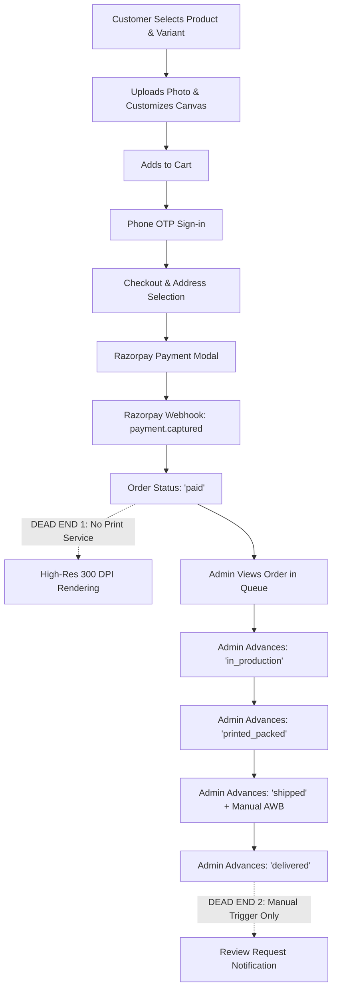

# BROPICS — COMPREHENSIVE PRODUCTION READINESS AUDIT

> **AUDIT TARGET:** `karthysgallery/Bro-pics` (Monorepo: `apps/web`, `functions`, `packages/shared`, `services/print-render`)  
> **SCOPE:** Full codebase architectural, security, operational, and UX inspection.  
> **DATE:** September 2026  
> **TARGET AUDIENCE:** Senior Technical Architects, Product Managers, and AI Engineers continuing development.

---

## EXECUTIVE SUMMARY

BroPics is an e-commerce platform for personalized photo frames (BroPics & Kavi Vazhi Photography). It replaces manual WhatsApp order workflows with an automated online customer customizer, checkout (Razorpay), and order management pipeline.

* **Current Architecture:** Next.js 15 (App Router), React 18, Tailwind CSS, Cloud Firestore, Firebase Storage, Firebase Auth (Phone OTP), Cloud Functions (v2), and Razorpay Payments.
* **Current Completion (Real Functionality):** **52%**
* **Primary Launch Blockers:**
  1. **Image Storage Expiration (Critical Bug):** Original uploads and preview renders store 1-hour expiring signed URLs in Firestore (`Upload.originalUrl`, `Customization.previewUrl`), causing broken images on historical orders and active cart sessions after 60 minutes.
  2. **Print Rendering Service is a Stub:** `services/print-render` is an empty 20-line Express server (`/health` returning `{ status: 'ok' }`). Zero 300 DPI high-resolution rendering code exists.
  3. **Admin Creation / Modification is UI-Only:** Forms for Products (`/admin/products/[id]`), Categories (`/admin/categories`), Frame Templates (`/admin/products/[id]/template`), and Homepage CMS (`/admin/homepage`) do not persist to Firestore (Save/Delete buttons only mutate local React state and display dummy notes).
  4. **Admin Dashboard Route Broken:** Visiting `/admin` yields an empty shell or 404 because no `page.tsx` exists at `apps/web/app/admin/page.tsx`.
  5. **No External Customer Notifications:** Payment, order confirmation, and shipping updates do not trigger SMS, Email, or WhatsApp API messages (only an in-app database notification bell exists).
  6. **Unsupported iPhone Image Uploads:** Sharp configuration fails on HEIC/HEIF files without conversion.

---

## PART 1 — COMPLETE ROUTE INVENTORY

### Customer Routes

| Route | Purpose | Main Components | Backend / API Used | Database Collections | Current Status | Missing Functionality |
| :--- | :--- | :--- | :--- | :--- | :--- | :--- |
| `/` | Storefront Homepage | `HeroSlider`, `CategoryTiles`, `ProductGrid`, `ProductRail`, `OfferStrip`, `HowItWorks`, `WhyUs`, `HomeReviewsCarousel`, `VideoRail`, `RecentlyViewedRail` | Server Components (`lib/firestore-homepage.ts`, `lib/firestore-categories.ts`) | `homepageSections`, `categories`, `products`, `reviews`, `products/{id}/media` | **IMPLEMENTED BUT NOT PRODUCTION READY** | Reads Firestore sections, but admin CMS to edit/save sections does not exist; relies on pre-seeded records. |
| `/category` | Category Index | `CategoryCard`, `Breadcrumb` | Server Component (`lib/firestore-categories.ts`) | `categories` | **FULLY IMPLEMENTED** | Basic grid listing active categories. |
| `/category/[slug]` | Category Product Grid & Filtering | `FilterPanel`, `ProductCard`, `useProductFilters` | Server Component + Client filters (`lib/firestore-products.ts`) | `categories`, `products` | **IMPLEMENTED BUT NOT PRODUCTION READY** | Multi-facet filtering is constrained due to Firestore inequality index requirements. |
| `/search` | Product Search Results | `SearchTypeahead`, `ProductCard` | Client Component (`/api/search-suggestions`, Firestore query plan) | `products` | **PARTIALLY IMPLEMENTED** | Algolia interface is stubbed; fallback uses basic Firestore prefix tokens (`searchTokens[]`). Full-text search is not live. |
| `/product/[slug]` | Product Detail & Inline Personalization | `ProductDetailClient`, `Gallery`, `PersonalizationEditor`, `EditorCanvas`, `BuyBox`, `ProductTabs`, `ReviewsSection`, `RelatedProducts` | Server Component + Client state (`lib/firestore-product-detail.ts`, `/api/uploads`, `/api/customizations`, `/api/frame-templates/[variantId]`) | `products`, `products/{id}/variants`, `products/{id}/media`, `products/{id}/frameTemplates`, `reviews`, `uploads`, `customizations` | **IMPLEMENTED BUT NOT PRODUCTION READY** | Personalization requires pre-existing `frameTemplates` in Firestore. Upload signed URLs expire in 1 hr. No HEIC support. |
| `/checkout` | Checkout & Razorpay Payment | `AddressPicker`, `AddressForm`, `RazorpayCheckoutScript` | Client Component (`/api/checkout/create-order`, `/api/checkout/coupon/validate`, Razorpay SDK) | `carts/{userId}`, `users/{userId}/addresses`, `orders`, `coupons`, `settings/shipping` | **IMPLEMENTED BUT NOT PRODUCTION READY** | **Zero guest checkout** (forces phone OTP sign-in). Requires client to poll/listen to order snapshot. |
| `/account` | Account Overview Dashboard | `AccountNav`, `RecentOrdersSummary`, `ProfileSnippet` | Client Component (`lib/auth-context.tsx`) | `users/{userId}`, `orders` | **FULLY IMPLEMENTED** | Profile overview with navigation tiles. |
| `/account/profile` | Profile Management | Profile Form, Profile Photo Uploader | Client Component (`/api/account/profile-picture`, Firebase Auth SDK) | `users/{userId}` | **FULLY IMPLEMENTED** | Phone number is immutable (credential); updates displayName and avatar. |
| `/account/addresses` | Shipping Address Book | `AddressList`, `AddressForm` | Client Component (`lib/auth-context.tsx`) | `users/{userId}/addresses` | **FULLY IMPLEMENTED** | CRUD for multiple addresses with default address toggle. |
| `/account/wishlist` | Saved Products Wishlist | `ProductCard`, `WishlistGrid` | Client Component (`/api/wishlist`, `/api/wishlist/merge`) | `users/{userId}/wishlist` | **FULLY IMPLEMENTED** | Supports localStorage sync to Firestore on login. |
| `/account/coupons` | Customer Available Coupons | `CouponCard` | Client Component (`/api/coupons/available`) | `coupons` | **FULLY IMPLEMENTED** | Lists active coupons applicable for customer. |
| `/account/notifications`| Notification Center | `NotificationList`, `NotificationItem` | Client Component (`/api/notifications`, `/api/notifications/[id]/read`) | `users/{userId}/notifications` | **PARTIALLY IMPLEMENTED** | In-app notification bell only. No SMS, Email, or WhatsApp dispatch. |
| `/account/reviews` | My Product Reviews | `ReviewCard`, `ReviewStatusBadge` | Client Component (`/api/reviews/mine`) | `reviews` | **FULLY IMPLEMENTED** | Shows customer's past submitted reviews and moderation status. |
| `/account/payment-methods`| Saved Payment Methods | Static Informational Card | Client Component | None | **UI ONLY** | Explains that Razorpay securely manages cards/UPI; no actual saved card tokens. |
| `/orders` | Order History Listing | `OrderListCard`, `OrderStatusBadge` | Client Component (`lib/auth-context.tsx`) | `orders` (query by `userId`) | **FULLY IMPLEMENTED** | Lists all placed orders sorted by date. |
| `/orders/[orderId]` | Order Detail & Tracking Timeline | `OrderStatusTimeline`, `OrderItemList`, `CancelOrderModal`, `ReturnRequestModal` | Client Component (`lib/order-lookup.ts`, `/api/orders/[orderId]/cancel`, `/api/orders/[orderId]/returns`) | `orders/{orderId}`, `orders/{orderId}/items`, `orders/{orderId}/events` | **FULLY IMPLEMENTED** | Live tracking stepper, timeline events, return and cancellation request buttons. |
| `/orders/[orderId]/invoice`| Printable HTML Invoice | Print-friendly HTML view | Client Component (`window.print()`) | `orders/{orderId}`, `orders/{orderId}/items` | **IMPLEMENTED BUT NOT PRODUCTION READY** | Browser print stylesheet only. No PDF generation or download server endpoint. |
| `/(content)/*` (`about`, `contact`, `faq`, `how-it-works`, `picture-quality-guide`, `privacy`, `return-refund-policy`, `shipping-policy`, `terms`) | Static Content & Policy Pages | `PageIntro`, static prose blocks | None (Static Server Components) | None | **FULLY IMPLEMENTED (STATIC)** | Fully hardcoded in `.tsx` files. No admin editing capability. |

---

### Admin Routes

| Route | Purpose | Main Components | Backend / API Used | Database Collections | Current Status | Missing Functionality |
| :--- | :--- | :--- | :--- | :--- | :--- | :--- |
| `/admin` | Main Admin Dashboard | None | None | None | **BROKEN / 404** | **No `page.tsx` exists at `/admin`**. Visiting `/admin` renders an empty layout shell or 404. |
| `/admin/products` | Product Catalog Table | Product Table, Filter | Client Component (`getDocs`) | `products` | **PARTIALLY IMPLEMENTED** | Read-only listing. Search, bulk operations, pagination, export are missing. |
| `/admin/products/[id]` | Product Create & Edit Form | Form with Title, Slug, Category, Pricing, PhotoSlots, Badges | Client Component | `products/{id}` (Read-only) | **UI ONLY / DUMMY** | **Save and Delete buttons ONLY update local React state and show a note.** No write API exists. Cannot create, edit, or delete products. |
| `/admin/products/[id]/template` | Frame Template & Text Zone Editor | Form with Mockup URL, Mask URL, Overlay URL, Text Zones, Clipart | Client Component | `products/{id}/variants`, `products/{id}/frameTemplates` (Read-only) | **UI ONLY / DUMMY** | **Save button only displays a local string note.** No write API exists. Cannot create or edit templates. |
| `/admin/categories` | Category Management | Category Table, Inline Form | Client Component (`getDocs`) | `categories` (Read-only) | **UI ONLY / DUMMY** | **Save and Delete buttons only mutate local React array state.** No backend write API exists. |
| `/admin/orders` | Production Queue & Order Fulfillment | Order Status Filter Table, Order Lookup, Status Transition Form | Client Component (`/api/staff/orders`, `/api/staff/orders/[orderNo]/advance`) | `orders`, `orders/{orderId}/items`, `orders/{orderId}/events` | **IMPLEMENTED BUT NOT PRODUCTION READY** | Can view orders and advance status. Cannot download print-ready files (print service stubbed). Preview image links expire after 1 hour. No courier API integration. |
| `/admin/returns` | Returns & Exchanges Queue | Return Queue Filter Table, Return Status Advance Form | Client Component (`/api/staff/returns`, `/api/staff/returns/[returnId]`) | `returns` | **IMPLEMENTED BUT NOT PRODUCTION READY** | Advances return state in DB, but **does NOT trigger Razorpay refund API**. Refund must be executed manually in Razorpay dashboard. |
| `/admin/reviews` | Customer Reviews Moderation | Pending Reviews List, Approve/Reject Actions | Client Component (`/api/staff/reviews`, `/api/staff/reviews/[id]/moderate`) | `reviews` | **FULLY IMPLEMENTED** | Approves/rejects reviews and updates product aggregate rating denormalization. |
| `/admin/homepage` | Homepage Section CMS | Form for Hero Banner and Closing CTA | Client Component | None | **UI ONLY / DUMMY** | **Save button only sets a local state string.** Does NOT persist to `homepageSections` in Firestore. |
| `/admin/roles` | Staff Role Assignment | Phone Lookup, Role Dropdown (`admin`, `staff`, null) | Client Component (`/api/admin/users/lookup`, `/api/admin/users/[uid]/role`) | Firebase Auth Custom Claims (`role`) | **FULLY IMPLEMENTED** | Assigns Firebase Auth custom claims by looking up customer phone numbers one by one. |
| `/admin/variants` | Variant Pricing & Matrix Editor | None | None | None | **NOT IMPLEMENTED** | No UI exists to create, edit, or delete variants. |
| `/admin/media` | Media & Asset Library | None | None | None | **NOT IMPLEMENTED** | No asset upload or media manager exists. |
| `/admin/customers` | Customer Directory & History | None | None | None | **NOT IMPLEMENTED** | Cannot view customer list, total spend, or customer accounts. |
| `/admin/coupons` | Coupon & Discount Manager | None | None | None | **NOT IMPLEMENTED** | Cannot create, disable, or manage coupons from UI. |
| `/admin/settings` | Store, Shipping & Tax Settings | None | None | None | **NOT IMPLEMENTED** | Shipping rates, GST, support contacts cannot be edited in admin. |
| `/admin/analytics` | Revenue & Operational Analytics | None | None | None | **NOT IMPLEMENTED** | Zero analytics, sales charts, conversion rates, or export tools. |

---

### Staff Routes

Staff members access the exact same endpoints as admin via their custom claim (`role: 'staff'`), restricted by `firestore.rules` and API route guards (`getStaffUserIdFromAuthHeader`).
- **Staff Order & Queue Management:** Handled at `/admin/orders` (formerly `/staff/orders`, consolidated into `/admin/orders`).
- **Staff Returns Queue:** Handled at `/admin/returns`.
- **Staff Review Moderation:** Handled at `/admin/reviews`.
- **Staff-specific standalone portal:** **NOT IMPLEMENTED** (Staff use `/admin/*` routes; permission checking allows `staff` on orders/returns/reviews, but `/admin/layout.tsx` blocks any user whose claim is not strictly `admin`).

---

## PART 2 — CURRENT CUSTOMER WEBSITE AUDIT

### 1. Homepage
* **Already Implemented:** Dynamic section rendering loop (`page.tsx`) mapping `homepageSections` documents to components; Hero carousel (`HeroSlider`), Category tiles (`CategoryTiles`), Best sellers grid (`ProductGrid`), Offer banner (`OfferStrip`), How it works (`HowItWorks`), Product video rail (`VideoRail`), Curated customer reviews carousel (`HomeReviewsCarousel`), Value proposition (`WhyUs`), and Recently viewed products rail (`RecentlyViewedRail`).
* **Partially Implemented:** Video playback uses static video URLs seeded in Firestore; no adaptive bitrate streaming (HLS/DASH).
* **Missing:** Factory/craftsmanship live tour, trust badges with dynamic verification links, newsletter capture, countdown flash sale timers.
* **Responsive / Mobile:** Yes, responsive CSS flex/grid layout with horizontal scrolling on mobile rails.
* **Dynamic Data:** Yes, fetched from Firestore with ISR revalidation (`revalidate = 60`).
* **Admin Controlled:** **NO.** While the page reads Firestore `homepageSections`, the Admin Homepage form (`/admin/homepage`) is dummy and does not write to Firestore.
* **Loading / Skeleton / Empty States:** Loading skeleton exists at `app/loading.tsx`. Empty states return `null` per section.
* **SEO & A11y:** Basic OpenGraph meta present; heading hierarchy is structured; skip links missing.
* **UX Quality:** Clean minimalist palette (cream, gold, brown); smooth CSS transitions.

### 2. Product Page (PDP)
* **Already Implemented:** Product info, price formatted in INR paise, compare-at strike-through, variant matrix selection (Size × Frame Colour/Design × Orientation), live stock status, dynamic delivery estimate timeline widget, tabbed specification details (`ProductTabs`), reviews list with 5-star rating breakdown, related products rail, and JSON-LD `Product` schema.
* **Partially Implemented:** Video rail displays only if video media records exist for that variant/product.
* **Missing:** "Frequently Bought Together" bundles, live pin-code serviceability checker (delivery timeline uses fixed business days, not courier API lookup).
* **Responsive / Mobile:** Fully responsive; on mobile, the primary CTA button width is constrained to `w-[calc(100%-5rem)]` to prevent floating WhatsApp button overlap.
* **Dynamic Data:** Fully dynamic, reading Firestore `products`, `variants`, `media`, and `frameTemplates`.
* **Admin Controlled:** Only via seed scripts or direct database edits.
* **Loading / Skeleton / Error:** Handled with Next.js `loading.tsx` and `notFound()`.
* **UX Quality:** High-quality micro-interactions, but gallery collapses directly into inline personalization editor once a template is loaded.

### 3. Personalization Engine (Inline PDP)
* **Already Implemented:** Native HTML5 2D `<canvas>` editor rendering frame mockup, photo crop, scale/zoom, 90° snapped rotation, offset drag, live DPI calculation with color badge (Green $\ge 300$, Yellow $150-299$, Red $<150$), low-DPI confirmation checkbox, text customization (Name & Date fields) with 8 Google Web Fonts, color picker, and multi-slot collage slot picker.
* **Partially Implemented:**
  - Multi-slot support: Engine supports multi-slot geometry, but seeded templates only have 1 slot.
  - Clipart picker: Component and schema exist, but clipart assets in seed data are sparse.
* **Missing:**
  - **HEIC/HEIF Image Support:** Upload route crashes if an iPhone user uploads raw HEIC files.
  - **Autosave / Local Session Drafts:** If user refreshes PDP mid-personalization, unsaved canvas transforms are lost.
  - **Undo / Redo buttons:** User must manually drag or click Reset.
  - **Free-angle rotation:** Only 0°, 90°, 180°, 270° supported.
  - **Print File Generation:** The 300 DPI high-resolution export does not exist.
* **Storage URL Expiration Bug:** Uploaded images and preview PNGs are stored with **1-hour expiring signed URLs** in Firestore. After 60 minutes, the customer cart and admin queue cannot display the image.

### 4. Cart
* **Already Implemented:** Cart slide-over drawer (`CartDrawer`), line items showing customized thumbnail preview, variant details, quantity stepper, remove item, subtotal calculation, free shipping progress bar, and checkout CTA.
* **Partially Implemented:** Edit personalization from cart: Clicking "Edit" does not rehydrate the canvas editor with prior transform coordinates; it opens the product page fresh.
* **Missing:** Cross-sell accessories in cart drawer, estimated tax calculation preview.
* **Responsive / Mobile:** Responsive slide-over drawer with touch dismiss.

### 5. Checkout
* **Already Implemented:** Delivery address picker and modal creator, coupon validation input with real-time discount deduction, shipping method toggle (Standard vs Express), server-side re-pricing against Firestore variants, Razorpay Orders API order creation, Razorpay Checkout modal, and Firestore `onSnapshot` confirmation listener.
* **Partially Implemented:**
  - Payment failure handling: User can retry in-place, but failed payment webhook does not alert user via SMS/Email.
* **Missing:**
  - **Guest Checkout:** Completely disabled. Unauthenticated users are blocked by `<SignedOutNotice />`.
  - **Partial COD / Pay on Delivery:** Only prepaid online payment is active.
  - **Stock Reservation / Locking:** Cart items are not locked during payment window; potential overselling under concurrent checkouts.

### 6. Account & Post-Purchase
* **Already Implemented:** Phone-OTP authentication via Firebase Auth Recaptcha, profile editing (name, avatar), address CRUD, wishlist sync (localStorage $\to$ Firestore), notification bell center, review submission modal with 1-5 star ratings, and order history listing.
* **Partially Implemented:**
  - Invoice: Renders HTML invoice and triggers `window.print()`. No backend PDF binary download.
* **Missing:**
  - One-click Reorder button.
  - Shipment courier live map tracking (only displays tracking number and courier name).

---

## PART 3 — ADMIN PANEL AUDIT

### Detailed Capability Matrix by Module

| # | Admin Module | Can Create? | Can Edit? | Can Delete/Archive? | Can Enable/Disable? | Can Sort/Reorder? | Bulk Edit? | Search/Filter? | Export Data? | Live Preview? | Hardcoded Content? | Requires Developer? |
| :--- | :--- | :--- | :--- | :--- | :--- | :--- | :--- | :--- | :--- | :--- | :--- | :--- |
| 1 | **Dashboard** | ❌ No | ❌ No | ❌ No | ❌ No | ❌ No | ❌ No | ❌ No | ❌ No | ❌ No | Yes (Empty) | **YES (Broken route)** |
| 2 | **Products** | ❌ Dummy | ❌ Dummy | ❌ Dummy | ❌ Dummy | ❌ No | ❌ No | ❌ No | ❌ No | ❌ No | No | **YES (No write API)** |
| 3 | **Variants** | ❌ No | ❌ No | ❌ No | ❌ No | ❌ No | ❌ No | ❌ No | ❌ No | ❌ No | Seeded | **YES (No UI exists)** |
| 4 | **Categories** | ❌ Dummy | ❌ Dummy | ❌ Dummy | ❌ Dummy | ❌ No | ❌ No | ❌ No | ❌ No | ❌ No | No | **YES (No write API)** |
| 5 | **Frame Templates**| ❌ Dummy | ❌ Dummy | ❌ Dummy | ❌ No | ❌ No | ❌ No | ❌ No | ❌ No | ❌ No | Seeded | **YES (No write API)** |
| 6 | **Media Library** | ❌ No | ❌ No | ❌ No | ❌ No | ❌ No | ❌ No | ❌ No | ❌ No | ❌ No | No | **YES (No UI exists)** |
| 7 | **Orders** | ❌ N/A | ⚠️ Status | ❌ No | ❌ No | ❌ No | ❌ No | Filter status| ❌ No | ❌ No | No | **YES (For printing/export)**|
| 8 | **Production Queue**| ❌ N/A | ⚠️ Status | ❌ No | ❌ No | ❌ No | ❌ No | Filter status| ❌ No | ❌ No | No | **YES (No print render)** |
| 9 | **Customers** | ❌ No | ❌ No | ❌ No | ❌ No | ❌ No | ❌ No | ❌ No | ❌ No | ❌ No | No | **YES (No UI exists)** |
| 10| **Customer Photos** | ❌ No | ❌ No | ❌ No | ❌ No | ❌ No | ❌ No | ❌ No | ❌ No | ❌ No | No | **YES (No asset viewer)** |
| 11| **Coupons** | ❌ No | ❌ No | ❌ No | ❌ No | ❌ No | ❌ No | ❌ No | ❌ No | ❌ No | Seeded | **YES (No UI exists)** |
| 12| **Offers / Discounts**| ❌ No | ❌ No | ❌ No | ❌ No | ❌ No | ❌ No | ❌ No | ❌ No | ❌ No | Seeded | **YES (No UI exists)** |
| 13| **Homepage Builder**| ❌ Dummy | ❌ Dummy | ❌ No | ❌ No | ❌ No | ❌ No | ❌ No | ❌ No | ❌ No | Seeded | **YES (No write API)** |
| 14| **Banners / Sliders**| ❌ No | ❌ No | ❌ No | ❌ No | ❌ No | ❌ No | ❌ No | ❌ No | ❌ No | Seeded | **YES (No UI exists)** |
| 15| **Reviews Moderation**| ❌ N/A | ✅ Approve | ✅ Reject | ✅ Yes | ❌ No | ❌ No | Filter status| ❌ No | ❌ No | No | **NO (Working)** |
| 16| **Videos CMS** | ❌ No | ❌ No | ❌ No | ❌ No | ❌ No | ❌ No | ❌ No | ❌ No | ❌ No | Seeded | **YES (No UI exists)** |
| 17| **Content Pages** | ❌ No | ❌ No | ❌ No | ❌ No | ❌ No | ❌ No | ❌ No | ❌ No | ❌ No | Hardcoded | **YES (Code edit needed)** |
| 18| **FAQ** | ❌ No | ❌ No | ❌ No | ❌ No | ❌ No | ❌ No | ❌ No | ❌ No | ❌ No | Hardcoded | **YES (Code edit needed)** |
| 19| **Policies** | ❌ No | ❌ No | ❌ No | ❌ No | ❌ No | ❌ No | ❌ No | ❌ No | ❌ No | Hardcoded | **YES (Code edit needed)** |
| 20| **Quality Guide** | ❌ No | ❌ No | ❌ No | ❌ No | ❌ No | ❌ No | ❌ No | ❌ No | ❌ No | Hardcoded | **YES (Code edit needed)** |
| 21| **Analytics** | ❌ No | ❌ No | ❌ No | ❌ No | ❌ No | ❌ No | ❌ No | ❌ No | ❌ No | None | **YES (No UI exists)** |
| 22| **Settings** | ❌ No | ❌ No | ❌ No | ❌ No | ❌ No | ❌ No | ❌ No | ❌ No | ❌ No | Seeded | **YES (No UI exists)** |
| 23| **Staff & Roles** | ❌ No | ✅ Role | ❌ No | ✅ Via Role| ❌ No | ❌ No | Single phone| ❌ No | ❌ No | No | **PARTIAL (Phone lookup)** |
| 24| **Returns / Refunds**| ❌ N/A | ⚠️ Advance | ❌ No | ❌ No | ❌ No | ❌ No | Filter status| ❌ No | ❌ No | No | **YES (Refund unlinked)** |
| 25| **Notifications** | ❌ No | ❌ No | ❌ No | ❌ No | ❌ No | ❌ No | ❌ No | ❌ No | ❌ No | None | **YES (No UI exists)** |
| 26| **Shipping Config** | ❌ No | ❌ No | ❌ No | ❌ No | ❌ No | ❌ No | ❌ No | ❌ No | ❌ No | Seeded | **YES (No UI exists)** |
| 27| **Payment Config** | ❌ No | ❌ No | ❌ No | ❌ No | ❌ No | ❌ No | ❌ No | ❌ No | ❌ No | Env vars | **YES (Dev only)** |
| 28| **SEO Management** | ❌ No | ❌ No | ❌ No | ❌ No | ❌ No | ❌ No | ❌ No | ❌ No | ❌ No | In code | **YES (Code edit needed)** |

### Critical Operational Verdict on Admin
The Admin panel in its current state **CANNOT run weekly operations without a developer**.
1. Products, Categories, and Frame Templates cannot be created or updated because their admin pages have **no write endpoints** (they explicitly set dummy local React state messages).
2. Coupons cannot be created for holidays/promotions without database scripts.
3. Shipping thresholds, banner announcements, and FAQ copy require database updates or code redeployments.
4. The business owner cannot download high-resolution print files from the admin orders page.

---

## PART 4 — DATA & DATABASE AUDIT

### 1. Database Architecture Overview
The platform uses **Cloud Firestore** in denormalized document format, supplemented by **Firebase Storage** for media files.

```
Firestore Root
├── categories/{categoryId}
├── products/{productId}
│   ├── variants/{variantId}
│   ├── media/{mediaId}
│   └── frameTemplates/{templateId}
├── homepageSections/{sectionId}
├── testimonials/{testimonialId}
├── reviews/{reviewId}
├── settings/{settingKey}
├── orders/{orderId}
│   ├── items/{itemId}
│   └── events/{eventId}
├── uploads/{uploadId}
├── customizations/{customizationId}
├── users/{userId}
│   ├── addresses/{addressId}
│   └── notifications/{notificationId}
├── coupons/{couponCode}
├── carts/{userId}
├── returns/{returnId}
├── webhookEvents/{eventId}
├── reconciliations/{reconciliationId}
└── counters/{counterId}
```

### 2. Business Entity Field & Schema Evaluation

#### `Product` (`products/{id}`)
* **Key Fields:** `title`, `slug`, `categoryId`, `shortDesc`, `basePrice`, `minPrice`, `maxPrice`, `availableSizes`, `availableColours`, `primaryImageUrl`, `hoverImageUrl`, `photoSlots`, `ratingAverage`, `ratingCount`, `isActive`, `inStock`, `allowsTextPersonalization`, `seo`.
* **Integrity / Duplication:** Filter fields (`minPrice`, `maxPrice`, `availableSizes`, `availableColours`) and images (`primaryImageUrl`, `hoverImageUrl`) are denormalized from the `variants` and `media` subcollections via Cloud Functions (`onVariantWritten`, `onMediaWritten`).
* **Vulnerability:** If a Cloud Function execution fails or encounters a timeout, the parent product's search cards become stale and show incorrect prices.

#### `Variant` (`products/{id}/variants/{id}`)
* **Key Fields:** `productId`, `sku`, `title`, `sizeLabel`, `widthIn`, `heightIn`, `frameColour`, `price`, `compareAtPrice`, `stockStatus`, `minUploadPx`.
* **Flaw:** Width and height are stored in physical inches (`widthIn`, `heightIn`), but aspect ratio orientation (`portrait`, `landscape`, `square`) is derived on the fly by the client (`orientation.ts`). No inventory count is stored (only enum `stockStatus: 'in_stock' | 'out_of_stock'`).

#### `FrameTemplate` (`products/{id}/frameTemplates/{id}`)
* **Key Fields:** `variantId`, `version`, `isCurrent`, `mockupUrl`, `maskUrl`, `overlayUrl`, `printableRects[]`, `textZones[]`, `clipartOptions[]`.
* **Major Architectural Flaw:**
  - `printableRects[]` defines fractional slots ($x, y, w, h$ between $0.0$ and $1.0$).
  - **No per-template text positioning was supported initially;** recent patches added `textZones[]`, but the schema allows only one global font size calculation. If an admin creates a variant without a frame template, the customer is physically blocked from adding that frame to the cart.

#### `Upload` (`uploads/{id}`)
* **Key Fields:** `sessionId`, `userId`, `originalUrl`, `widthPx`, `heightPx`, `mime`, `bytes`, `exifStripped`, `status`.
* **CRITICAL FLAW:** `originalUrl` is populated via `storageFile.getSignedUrl({ action: 'read', expires: Date.now() + 3600000 })`. It stores an **expiring 1-hour signed URL** in the document database! Any upload queried after 1 hour breaks with broken image links.

#### `Customization` (`customizations/{id}`)
* **Key Fields:** `sessionId`, `userId`, `uploadId`, `variantId`, `slotIndex`, `transformJson` (scale, offsetX, offsetY, rotationDeg, cropRect), `templateVersion`, `previewUrl`, `textFieldsJson`, `renderStatus`.
* **Flaw:** `textFieldsJson` stores the custom text string, font key, and color. However, `renderStatus` stays perpetually in `'pending'` because no backend consumer exists to render the print file.

#### `Cart` (`carts/{userId}`)
* **Key Fields:** `userId`, `items[]` (`variantId`, `personalizationId`, `title`, `qty`, `unitPriceSnapshot`, `previewUrl`, `sizeLabel`, `frameColour`).
* **Security Anomaly:** `firestore.rules` grants direct client write access: `allow read, write: if isOwner(userId);`. A malicious user can write any arbitrary payload into their cart document directly from browser developer tools. (Mitigated at checkout by server re-pricing, but creates malformed document risks).

#### `Order` (`orders/{id}`) & `OrderItem` (`orders/{id}/items/{id}`)
* **Key Fields:** `orderNo`, `userId`, `status`, `paymentStatus`, `paymentMode`, `total`, `subtotal`, `discount`, `shipping`, `tax`, `addressJson`, `razorpayOrderId`, `razorpayPaymentId`, `placedAt`.
* **Historical Order Breakdown Risk:** `OrderItem` copies variant snapshot details, but `customizationId` points to the `customizations` collection. Because uploaded images expire after 1 hour, opening a historical order in Admin displays blank broken images for the customer's photo and customization preview.

---

## PART 5 — API & BACKEND AUDIT

### Complete API Route Inventory

| Route | Method | Auth Required | Input Validation | Rate Limited | External APIs | Purpose & Current Status |
| :--- | :---: | :---: | :---: | :---: | :---: | :--- |
| `/api/uploads` | POST | Anonymous Session ID (`X-Session-Id`) | File instanceof Blob, Sharp image probe | ✅ Yes (`upload`: 30/min) | Firebase Storage | Strips EXIF and uploads original photo. **Status:** Working, but signs URL for only 1 hour. No HEIC. |
| `/api/uploads/preview` | POST | Session ID | Regex dataUrl check, Sharp probe | ✅ Yes (`upload`: 30/min) | Firebase Storage | Saves canvas preview image data URL to storage. **Status:** Working (1-hour expiration). |
| `/api/customizations` | POST | Session ID | Zod schema parse (`CustomizationSchema`) | ❌ No | None | Saves transform geometry & crop coordinates to Firestore. **Status:** Working. |
| `/api/frame-templates/[variantId]` | GET | Public | None | ❌ No | None | Fetches active frame templates for a variant. **Status:** Working. |
| `/api/checkout/create-order` | POST | Authenticated User | Cart line integrity, Address schema, Delivery method | ✅ Yes (`checkout`: 10/min) | Razorpay Orders API | Validates cart, recomputes pricing against DB variants, creates Razorpay order, writes `pending_payment` order. **Status:** Working. |
| `/api/checkout/coupon/validate` | POST | Authenticated User | String code, minOrder check, expiration window | ✅ Yes (`coupon`: 20/min) | None | Checks coupon validity against subtotal. **Status:** Working. |
| `/api/coupons/available` | GET | Authenticated User | None | ❌ No | None | Lists applicable coupons for current user. **Status:** Working. |
| `/api/variants/[variantId]/product` | GET | Public | None | ❌ No | None | Reverse lookup for product from variant ID. **Status:** Working. |
| `/api/search-suggestions` | GET | Public | Query string length | ❌ No | None | Returns search typeahead suggestions using Firestore token prefix. **Status:** Working (Interim). |
| `/api/wishlist` | GET/POST/DEL | Authenticated User | Product ID validation | ❌ No | None | CRUD operations on customer wishlist. **Status:** Working. |
| `/api/wishlist/merge` | POST | Authenticated User | Array of product IDs | ❌ No | None | Merges anonymous localStorage wishlist into Firestore on sign-in. **Status:** Working. |
| `/api/notifications` | GET | Authenticated User | None | ❌ No | None | Retrieves user in-app notifications. **Status:** Working. |
| `/api/notifications/[id]/read` | POST | Authenticated User | ID check | ❌ No | None | Marks notification read. **Status:** Working. |
| `/api/account/profile-picture` | POST | Authenticated User | Sharp probe, size limit | ❌ No | Firebase Storage, Auth | Updates profile avatar URL. **Status:** Working. |
| `/api/auth/revoke-sessions` | POST | Authenticated User | None | ❌ No | Firebase Auth | Revokes refresh tokens on logout. **Status:** Working. |
| `/api/orders/[orderId]/cancel` | POST | Authenticated User (Owner) | Current status == `paid` check | ❌ No | None | Cancels order before production starts. **Status:** Working, but does NOT trigger Razorpay refund automatically. |
| `/api/orders/[orderId]/returns` | POST | Authenticated User (Owner) | Reason, Item IDs | ❌ No | None | Submits return request for delivered order. **Status:** Working. |
| `/api/reviews` | POST | Authenticated User | Rating 1-5, title, body | ❌ No | None | Submits product review with verified purchase check. **Status:** Working. |
| `/api/reviews/mine` | GET | Authenticated User | None | ❌ No | None | Fetches customer's submitted reviews. **Status:** Working. |
| `/api/staff/orders` | GET | Staff or Admin Claim | Status filter query | ❌ No | None | Returns orders for queue view. **Status:** Working. |
| `/api/staff/orders/[orderNo]` | GET | Staff or Admin Claim | Order number | ❌ No | None | Fetches full order detail for fulfillment. **Status:** Working. |
| `/api/staff/orders/[orderNo]/advance` | POST | Staff or Admin Claim | Valid status transition check | ❌ No | None | Transitions order status (`paid` $\to$ `in_production` $\to$ `printed_packed` $\to$ `shipped` $\to$ `delivered`). **Status:** Working. |
| `/api/staff/returns` | GET | Staff or Admin Claim | Status filter | ❌ No | None | Returns queue. **Status:** Working. |
| `/api/staff/returns/[returnId]` | POST | Staff or Admin Claim | Valid return transition | ❌ No | None | Advances return state. **Status:** Working. |
| `/api/staff/reviews` | GET | Staff or Admin Claim | Status filter | ❌ No | None | Pending reviews queue. **Status:** Working. |
| `/api/staff/reviews/[id]/moderate`| POST | Staff or Admin Claim | Action: approve / reject | ❌ No | None | Approves or rejects customer review. **Status:** Working. |
| `/api/admin/users/lookup` | GET | Admin Claim Only | Phone query parameter | ❌ No | Firebase Auth | Looks up user record by phone. **Status:** Working. |
| `/api/admin/users/[uid]/role` | POST | Admin Claim Only | Role string: `admin`, `staff`, `null` | ❌ No | Firebase Auth | Sets custom claim role. **Status:** Working. |

---

### Cloud Functions Audit (`functions/src`)

1. **`razorpayWebhook` (`webhooks/razorpay.ts`):**
   - **Signature Verification:** Uses `crypto.createHmac('sha256', secret)` with `crypto.timingSafeEqual`.
   - **Idempotency:** Transactions verify `webhookEvents/{eventId}` before execution. Redeliveries are dropped.
   - **Order Update:** Flips status to `'paid'`, records `orderEvent`, and clears customer cart.
   - **Missing:** **Does NOT trigger print render job. Does NOT send confirmation SMS, Email, or WhatsApp message.**
2. **`onVariantWritten` (`products/denormalize.ts`):**
   - Denormalizes `minPrice`, `maxPrice`, `availableSizes`, `availableColours` onto `products/{id}` document.
3. **`onMediaWritten` (`products/denormalize-media.ts`):**
   - Denormalizes `primaryImageUrl` and `hoverImageUrl` onto `products/{id}`.
4. **`onReviewWritten` (`products/denormalize-ratings.ts`):**
   - Recomputes `ratingAverage` and `ratingCount` on `products/{id}` upon review approval.
5. **`reconcileSessionOnLogin` (`accounts/reconcile-session.ts`):**
   - Reconciles anonymous session uploads, customizations, and cart lines to the logged-in user ID upon auth trigger.

---

## PART 6 — SECURITY AUDIT

### Severity Findings Matrix

| Finding | Severity | Component | Description & Attack Vector | Impact |
| :--- | :---: | :--- | :--- | :--- |
| **All Firebase Storage access denied by default** | **CRITICAL** | `storage.rules` | `allow read, write: if false;` applies to the entire bucket. Client cannot fetch assets directly. | To bypass this, API issues signed URLs, but because signed URLs expire in 60 min, customer and admin image access breaks permanently after 1 hr. |
| **1-Hour Expiring Image URLs in Database** | **CRITICAL** | `/api/uploads`, `/api/uploads/preview` | Upload routes store temporary `getSignedUrl` URLs directly in `Upload.originalUrl` and `Customization.previewUrl`. | Production and historical orders lose all access to customer images after 1 hour, making order fulfillment impossible. |
| **Direct Client-Writable Cart Collection** | **HIGH** | `firestore.rules` (`match /carts/{userId}`) | Rules allow `allow read, write: if isOwner(userId);`. Customers can inject arbitrary JSON into cart documents. | Mitigated at checkout by server re-pricing, but vulnerable to stored XSS if cart line titles are rendered unescaped in admin or client drawers. |
| **No Automated Refund Trigger on Order Cancellation** | **HIGH** | `/api/orders/[orderId]/cancel` | User can cancel order while status is `paid`. Route flips status to `cancelled` and records event, but **never calls Razorpay Refunds API**. | Customer payment is retained. Client must manually discover cancellation and manually issue refund inside Razorpay dashboard. |
| **Admin Route Security Relies on Client Layout** | **MEDIUM** | `apps/web/app/admin/layout.tsx` | Admin authorization check occurs inside client-side `useEffect`. | Malicious user cannot execute Admin SDK APIs (which verify `role === 'admin'`), but can see admin page structure and flashes of UI before redirect. |
| **In-Memory Rate Limiting** | **MEDIUM** | `lib/rate-limit.ts` | Rate limiter uses an in-memory Map (`LRUCache`). | On multi-instance deployments (Firebase App Hosting / Cloud Run), rate limits are not shared across server instances, allowing distributed bypass. |
| **Missing Content Security Policy (CSP)** | **MEDIUM** | `next.config.ts` | No CSP headers configured to restrict canvas data exfiltration or script injection. | Potential risk if third-party tracking scripts are added later. |
| **Anonymous Session ID Spoofing** | **LOW** | `lib/session-id.ts` | Anonymous session ID is an untrusted client UUID stored in `localStorage`. | An attacker guessing another user's session ID could link customizations if the target has not logged in. |

---

## PART 7 — PERSONALIZATION ENGINE AUDIT

### Canvas & Transformation Verification
* **Canvas Framework:** Native HTML5 2D Context (`<canvas>`), running in an isolated dynamic client component (`EditorCanvas.tsx` with `ssr: false`).
* **Aspect Ratio & Geometry Math:** Implemented in `packages/shared/src/editor-geometry.ts`. Correctly transforms normalized fractional coordinates ($0.0 - 1.0$) to canvas pixel coordinates.
* **Crop & Zoom Math:**
  - `coverScale()` enforces minimum zoom such that the image always covers the printable slot rectangle (no empty transparent borders).
  - Maximum zoom capped at $4\times$ cover scale.
  - Centered offset preserves pan focus during zoom steps.
* **Rotation Snapping:** Snaps strictly to 0°, 90°, 180°, and 270°. At 90° and 270°, dimensions and aspect ratios are axis-swapped (`printDimensionsForRotation`).
* **DPI Engine:**
  - Calculates real printable DPI from physical inches and cropped original pixel density:
    $$\text{effectiveDpi} = \frac{\text{cropPixelWidth}}{\text{physicalWidthInches}}$$
  - Green ($\ge 300\text{ DPI}$), Yellow ($150 - 299\text{ DPI}$), Red ($< 150\text{ DPI}$).
  - Red tier blocks checkout unless the user explicitly checks the confirmation checkbox.

### Major Production Blockers in Personalization
1. **HEIC / HEIF Failure:**
   Modern iPhones take photos in HEIC format by default. `image-probe.ts` only supports `jpeg`, `png`, and `webp`. **Uploading an iPhone photo crashes with an unsupported format error.**
2. **Missing Print File Generation (Cloud Run Stub):**
   When an order is placed, only a low-res client canvas data URL preview is saved. The production server `services/print-render` has **zero rendering code** (it is a blank 20-line Express server returning `{ status: 'ok' }`). There is **no mechanism to generate a 300 DPI high-resolution composite print file**.
3. **Canvas Tainting & CORS:**
   If the frame mockup image is hosted on an external bucket without `cors.json` headers, calling `canvas.toDataURL()` throws a browser `SecurityError` (tainted canvas), preventing the preview from uploading.

---

## PART 8 — ORDER & PRODUCTION WORKFLOW AUDIT

### End-to-End Lifecycle Trace



### Trace Breakdown & Breakpoints
1. **Customer Places Order:** Working. Order created as `pending_payment`.
2. **Payment Captured:** Working. Webhook verifies signature and marks order `paid`.
3. **Print Rendering:** **BROKEN / MISSING.** The pipeline stops here. The Cloud Run service has no print rendering logic. Staff has no high-res print file to send to physical printing machines.
4. **Production Queue:** Working at UI level. Staff can advance status through `in_production` $\to$ `printed_packed` $\to$ `shipped` $\to$ `delivered`.
5. **Shipping & AWB:** Staff can type in a courier name and AWB number. However, **there is no shipping API integration** (no Shiprocket, Delhivery, or Bluedart API). AWBs must be typed manually.
6. **Delivery Confirmation:** Staff manually marks order `delivered`. No automated webhook from couriers.

---

## PART 9 — CUSTOMER NOTIFICATIONS AUDIT

| Event | In-App Bell | Email | SMS | WhatsApp | Actual Working Status |
| :--- | :---: | :---: | :---: | :---: | :--- |
| **Order Placed / Payment Successful** | ❌ Missing | ❌ No | ❌ No | ❌ No | **NOT WORKING.** Webhook explicitly omits notification dispatch. |
| **Payment Failed** | ❌ Missing | ❌ No | ❌ No | ❌ No | **NOT WORKING.** No notification dispatched. |
| **Order In Production** | ✅ Working | ❌ No | ❌ No | ❌ No | In-app DB notification only. Customer must be on the website. |
| **Order Shipped (with AWB)** | ✅ Working | ❌ No | ❌ No | ❌ No | In-app DB notification only. Customer receives no SMS/WhatsApp. |
| **Order Delivered** | ✅ Working | ❌ No | ❌ No | ❌ No | In-app DB notification only. |
| **Review Request** | ❌ Missing | ❌ No | ❌ No | ❌ No | Not automated upon delivery. |

* **WhatsApp Integration Reality:** The site only contains a hardcoded static link button to `https://wa.me/91XXXXXXXXXX`. **Zero WhatsApp Business API / Cloud API integration exists.**

---

## PART 10 — PERFORMANCE & BOTTLENECKS

1. **Incremental Static Regeneration (ISR):**
   Product and Category pages use `revalidate = 60`. In Firebase App Hosting (Cloud Run), ISR operates on a per-container basis. Different instances maintain separate page caches, leading to inconsistent inventory views during concurrent scaling.
2. **Firestore Read Amplification:**
   On product pages, variants, media, reviews, and related products execute multiple round-trip subcollection queries. High traffic will rapidly consume Firestore read quotas.
3. **Personalization Memory Load:**
   Manipulating multi-megapixel user uploads directly on an HTML5 canvas in mobile Safari frequently triggers iOS WebKit memory limits, resulting in spontaneous canvas blanking or page reloads.

---

## PART 11 — SEO AUDIT

* **Metadata & Canonicals:** Correctly configured on product and category pages (`generateMetadata` with canonical URLs).
* **Robots & Sitemap:** `robots.ts` and `sitemap.ts` dynamically generate valid XML/text paths for categories and products.
* **Structured Data:** Schema.org `Product`, `Offer`, and `AggregateRating` JSON-LD are injected on the product detail page.
* **Missing Elements:**
  - BreadcrumbList Schema is absent.
  - Organization / LocalBusiness Schema is absent.
  - OpenGraph image tags fallback to empty strings if primary image URL is missing.
  - Faceted search parameter URLs (`/category/slug?size=8x10`) lack proper canonicalization to the base category, risking duplicate content indexing.

---

## PART 12 — RESPONSIVE & MOBILE AUDIT

1. **Header & Navigation:** Mobile navigation uses a slide-out hamburger drawer with clean touch targets.
2. **Personalization Editor on Small Screens:**
   - The editor forces a 3-column layout on desktop (`canvas | controls | buy box`), which stacks into a single vertical column on mobile.
   - On screens smaller than 380px, the canvas and zoom/rotate controls consume the entire viewport height, requiring extensive vertical scrolling to access text fields and Add-to-Cart.
3. **WhatsApp Floating Action Button Conflict:**
   The fixed WhatsApp FAB (`bottom-6 right-6`) overlaps bottom action sheets and checkout primary CTA buttons on small mobile displays unless explicit padding is injected.
4. **Touch Gestures:** Canvas drag and offset use pointer events, but **pinch-to-zoom is not implemented**. Mobile users must tap small `+` and `-` zoom buttons rather than pinching the screen.

---

## PART 13 — UI / UX PRODUCTION AUDIT

* **Visual Polish:** High aesthetic appeal using warm cream, gold accents, and deep coffee brown typography. Avoids generic templates.
* **Form & Validation Friction:**
  - Phone sign-in requires invisible Recaptcha which frequently triggers multi-step image verification on mobile networks, degrading checkout conversion.
* **Skeleton Loaders:** Implemented for initial page loads (`PageSkeleton`), but missing for intermediate async actions (e.g., advancing order queues or uploading avatar).
* **Toasts & Feedback:** Toast notification provider exists (`Toast.tsx`), but several error catches still render raw red paragraph text (`<p className="text-red-600">`) instead of clean toast alerts.

---

## PART 14 — HARDCODED CONTENT AUDIT

The following items are completely hardcoded in repository source files and **cannot be edited by store administrators**:

1. **Business Contact:** Support email `support@bropics.in` hardcoded in `apps/web/lib/support-contact.ts`.
2. **WhatsApp Support Phone:** Fallback phone number hardcoded in `components/layout/WhatsAppButton.tsx`.
3. **All Informational Pages:** 100% of copy in `/about`, `/contact`, `/faq`, `/how-it-works`, `/picture-quality-guide`, `/privacy`, `/return-refund-policy`, `/shipping-policy`, `/terms`.
4. **Trust Badges:** "Secure packaging", "High quality prints", "Perfect for gifting" hardcoded in `BuyBox.tsx`.
5. **Shipping Methods:** Transit days ($1-2$ days express, $3-5$ days standard) hardcoded in `checkout-calc.ts`.
6. **Font Palette:** Curated font list (8 Google Fonts) hardcoded in `text-personalization-options.ts`.
7. **Orientation Labels:** Hardcoded mappings in `orientation.ts`.

---

## PART 15 — ENVIRONMENT & DEPLOYMENT AUDIT

* **Firebase Target:** Configured for project `bropics-app`.
* **Razorpay Keys:** Only test key identifiers are specified in `.env.example`. Webhook secrets must be manually registered in Firebase Functions config.
* **Cloud Run Service (`services/print-render`):**
  - Contains a `Dockerfile` with Node 20 alpine.
  - **No deployment pipeline exists** in GitHub Actions or `firebase.json` for this service.
* **Missing Production Infrastructure:**
  - Sentry / Datadog error monitoring is **completely missing**.
  - Structured application logging is absent (uses standard `console.error`).
  - No automated daily Firestore backup routine is configured.

---

## PART 16 — TESTING AUDIT

* **Unit & Component Tests:** Extensive unit testing exists (120+ test files in Vitest covering schemas, geometric math, rate-limiting, and component render mocks).
* **Firestore Security Rules Tests:** Complete emulator-based rule suite in `firestore-rules-tests/rules.test.ts`.
* **CRITICAL TESTING GAPS:**
  - **Zero End-to-End (E2E) Tests:** No Playwright or Cypress tests. The complete flow (Upload $\to$ Personalize $\to$ Cart $\to$ Razorpay Modal $\to$ Webhook) has never been tested in an automated CI pipeline.
  - **Zero Live Razorpay Integration Tests:** Payments are only tested with mocks.
  - **Zero Real Cloud Storage Upload Tests:** Image probe tests run against static mock buffers; real network multipart uploads to GCP buckets are untested in CI.

---

## PART 17 — COMPREHENSIVE STATUS MATRIX

| Module | Status | Current Implementation | Missing Items | Production Blocker? | Priority |
| :--- | :--- | :--- | :--- | :---: | :---: |
| **Customer Storefront** | FULLY IMPLEMENTED | Dynamic ISR pages, grids, rails | Real Algolia search index | No | P2 |
| **Product Customizer** | PARTIALLY IMPLEMENTED | Canvas crop, zoom, rotate, text | HEIC upload support, pinch zoom | **YES** | **P0** |
| **High-Res Print Engine**| NOT IMPLEMENTED | Express health check stub | Sharp/Canvas 300 DPI composite pipeline | **YES** | **P0** |
| **Image Storage & URLs** | BROKEN | 1-hour signed URLs stored in DB | Permanent storage pathing / auto-refresh | **YES** | **P0** |
| **Cart Persistence** | FULLY IMPLEMENTED | Local state + Firestore sync | Re-edit personalization from cart | No | P2 |
| **Guest Checkout** | NOT IMPLEMENTED | Blocked; OTP login required | Unauthenticated checkout flow | No | P1 |
| **Razorpay Payments** | FULLY IMPLEMENTED | Orders API + Webhook signature | Automated refund execution API | No | P1 |
| **Customer Notifications**| MOCKED / UI ONLY | In-app notification bell only | Email, SMS, WhatsApp Business API | **YES** | **P0** |
| **Admin Dashboard** | BROKEN | No route exists (`/admin` is 404) | Dashboard overview & statistics page | **YES** | **P0** |
| **Admin Catalog CRUD** | UI ONLY / DUMMY | Forms only log local state notes | Write APIs for Products, Categories, Variants| **YES** | **P0** |
| **Admin Templates CRUD**| UI ONLY / DUMMY | Canvas preview form only | Write API for FrameTemplates & TextZones | **YES** | **P0** |
| **Admin Order Queue** | PARTIALLY IMPLEMENTED | Status progression working | High-res print file download, Courier API | **YES** | **P0** |
| **Admin Returns Queue** | PARTIALLY IMPLEMENTED | Status progression working | Automated Razorpay refund integration | No | P1 |
| **Admin CMS & Content** | NOT IMPLEMENTED | Static hardcoded TSX pages | Content CMS for FAQ, Policies, Banners | No | P2 |
| **Admin Coupon Manager**| NOT IMPLEMENTED | Seeded records in Firestore | Admin UI to create, toggle, edit coupons | **YES** | **P1** |
| **Courier Integration** | NOT IMPLEMENTED | Manual AWB & courier name typing | Shiprocket / Nimbus API integration | No | P2 |
| **Error Monitoring** | NOT IMPLEMENTED | Standard console logs | Sentry / LogRocket instrumentation | **YES** | **P1** |

---

## PART 18 — FINAL VERDICT & ARCHITECTURAL SUMMARY

### A. What is Genuinely Complete
1. **Frontend Visual System & Core PDP:** High-quality aesthetic styling, variant selector scoping, orientation derivation, and dynamic delivery timeline calculations.
2. **Personalization Geometry Math:** Pixel-perfect crop, zoom bounds, snap rotations, and dual-boundary client/server DPI math in `packages/shared`.
3. **Cart & Re-pricing Security Boundary:** Server recalculates cart line totals and promotions against database variants, preventing client-side price tampering.
4. **Razorpay Webhook Verification:** Cryptographic HMAC signature validation with double-guarded database transaction idempotency.
5. **Review Moderation Pipeline:** Verified purchase enforcement, customer submission, admin moderation, and automatic product rating denormalization.

### B. What is Only Partially Complete
1. **Customer Order Tracking:** Displays live status history in-app, but lacks automated courier sync and external tracking webhooks.
2. **Search:** Operates via basic Firestore string-token queries; Algolia integration interface exists but has no active provider configuration.
3. **Admin Order Queue:** Displays orders and advances statuses, but cannot generate or download high-resolution print files.
4. **Returns Management:** Advances return state in the database without issuing refunds through Razorpay.

### C. What is UI-Only (No Backend Writes)
1. **Admin Product Editor (`/admin/products/[id]`):** Fully constructed form that **only writes to local React state**.
2. **Admin Category Editor (`/admin/categories`):** Fully constructed form that **only mutates a local state array**.
3. **Admin Frame Template Builder (`/admin/products/[id]/template`):** Interactive template zone editor that **cannot persist to Firestore**.
4. **Admin Homepage Editor (`/admin/homepage`):** Form that **does not write to `homepageSections`**.
5. **Account Payment Methods:** Informational UI card only.

### D. What is Backend-Only (No Admin UI)
1. **Coupons:** Full validation, discount calculation, and checkout deduction logic exists, but **no admin UI exists to create or manage coupons**.
2. **Homepage Sections:** Firestore structure and storefront renderer exist, but **no working admin CMS exists to modify them**.
3. **Store Settings (`settings/shipping`):** Database lookup and free shipping calculation exist, but **no admin UI exists to configure rates**.

### E. What is Mocked
1. **Print Rendering Service (`services/print-render`):** A dummy Express server returning `{ status: 'ok' }` without any image processing capabilities.
2. **Delivery Timeline:** Calculates fixed calendar days; not connected to courier postal code serviceability APIs.
3. **WhatsApp Integration:** Plain anchor tags pointing to `wa.me`; zero automated WhatsApp API triggers.

### F. What is Broken
1. **Admin Root Route (`/admin`):** Accessing `/admin` yields an empty shell or 404 because no `page.tsx` exists at that route.
2. **Image Storage URL Lifespan:** Uploads and canvas previews store temporary 1-hour signed URLs in Firestore, breaking image links on older orders and cart items.
3. **HEIC Image Uploads:** Sharp configuration throws unhandled exceptions on standard iPhone camera uploads.
4. **Order Cancellation Refunds:** Cancelling a paid order leaves customer money captured in Razorpay without triggering an automated refund.

### G. What is Missing
1. Automated customer communication channels (Transactional Emails, SMS, WhatsApp Business API).
2. Automated 300 DPI composite print file generation pipeline.
3. Production error tracking (Sentry) and server health telemetry.
4. Customer management directory and sales analytics in Admin.
5. End-to-end automated testing suites.

---

### H. What Prevents Production Launch (Blockers)

```
[CRITICAL BLOCKERS FOR LAUNCH]
│
├── 1. STORAGE: Fix 1-Hour Expiring Signed URLs (Switch to persistent Storage paths + signed URL on-demand generation)
├── 2. PRINT ENGINE: Implement actual 300 DPI composite Sharp rendering in services/print-render
├── 3. ADMIN CRUD: Implement Firestore write endpoints for Products, Categories, and Frame Templates
├── 4. NOTIFICATIONS: Wire SendGrid/Resend (Email) and Fast2SMS/Twilio (SMS) for payment and order confirmation
├── 5. FORMAT SUPPORT: Add HEIC/HEIF conversion pipeline for mobile iPhone image uploads
└── 6. ADMIN DASHBOARD: Create missing /admin/page.tsx with operational metrics and order overview
```

---

### I. Recommended Implementation Order for Next Phase

1. **Sprint 1 — Core Data & Storage Fixes (Days 1–3):**
   - Refactor `Upload.originalUrl` to store the permanent GCP Storage path (`gs://...` or bucket-relative key). Build an API endpoint to generate fresh signed read URLs on demand.
   - Add `heic-convert` or compile Sharp with `libheif` support in `/api/uploads`.
   - Implement `/admin/page.tsx` dashboard and wire genuine write API endpoints for `/admin/products`, `/admin/categories`, and `/admin/products/[id]/template`.

2. **Sprint 2 — High-Res Print Generation Pipeline (Days 4–7):**
   - Implement the Sharp compositing engine inside `services/print-render`:
     - Load original high-res customer upload from Storage.
     - Apply stored crop rectangle, scale, and snapped rotation at 300 DPI output dimensions.
     - Overlay template mask and render text fields using local TTF fonts.
     - Upload finished print-ready TIFF/PDF/PNG back to a protected Storage bucket.
   - Wire Cloud Function trigger on `order.status == 'paid'` to call `print-render`.
   - Add "Download High-Res Print File" button in Admin Order Detail.

3. **Sprint 3 — Customer Communications & Automation (Days 8–10):**
   - Integrate transactional email (Resend / SendGrid) and SMS (MSG91 / Fast2SMS).
   - Dispatch messages on `payment.captured`, `order.shipped` (with tracking URL), and `order.delivered`.
   - Wire Razorpay Refund API to `/api/orders/[orderId]/cancel` and `/api/staff/returns/[id]`.

4. **Sprint 4 — Operational Admin & Pre-Launch Hardening (Days 11–14):**
   - Build `/admin/coupons` manager and `/admin/settings` editor.
   - Setup Sentry error monitoring across `apps/web` and `functions`.
   - Conduct full end-to-end sandbox purchase with live Razorpay test webhooks on mobile devices.

---

### J. Estimated Real Completion Percentage

$$\mathbf{52\% \text{ Production Ready}}$$

* **Storefront UI & Design:** **90%** (Aesthetic, responsive, smooth micro-interactions).
* **Personalization Frontend:** **80%** (Canvas math, DPI calculation, and text options are solid; lacks HEIC & pinch-zoom).
* **Payment & Cart Security:** **85%** (Server re-pricing and webhook HMAC idempotency are solid).
* **Backend Fulfillment & Print Production:** **15%** (Print rendering is non-existent; storage URLs expire after 1 hour).
* **Customer Communications:** **10%** (Only in-app notification bell works; zero email, SMS, or WhatsApp).
* **Admin Operational Control:** **25%** (Read-only tables and status transitions work; all creation/editing forms are non-persisting mocks).
